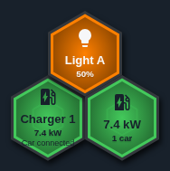
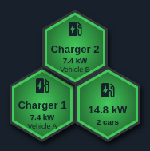
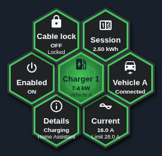
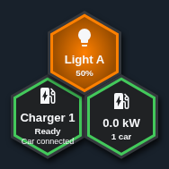
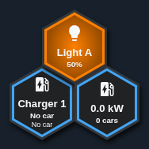
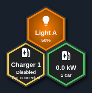
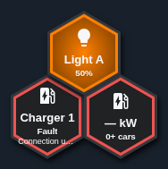
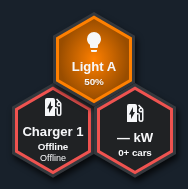
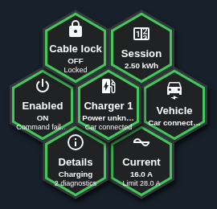

# Charger beta verification and owner handoff

The functional baseline is published v1.8.1, commit
`c1f178740c8181921033d0d18e0ac8d01afc7ea7`, which has no Charger module.
This beta adds the generic/Easee frontend described in [the module guide](CHARGER_MODULE.md).
It preserves the shared renderer, allocator, native Sonos and Light modules.
These are synthetic HA fixtures and production-bundle screenshots, not owner hardware.

## Validation scope

- 20 Charger unit cases: exact mapping, normalization, measurements, association,
  safe controls, confirmation, reconnection, deduplication and dependency updates.
- 10 browser scenarios at each of 1100×900 and touch-enabled 390×844: all state
  colors, named chargers, promoted fixed detail slots, explicit switch targets,
  denied/late discovery, expiry, idle close, command failures and cleanup.
- Complete one/two-charger dashboard YAML is parsed and mounted in the browser.
  Zero and 26 configured chargers, fixed 60/82px sizing, automatic 41px sizing,
  keyboard activation, reduced motion and the existing 24-wave budget are checked.
- 100 unrelated HA updates cause zero renders on the observed Charger face.
  Changing power preserves the existing animation instance. Read-only detail
  fields ignore power changes that do not affect their presentation.
- Ordinary navigation never invokes a charging service. Synthetic intentional
  taps invoke exactly the verified switch target; no vendor/cloud API is used.
- Mandatory CI retains all previous contract, desktop/mobile, original-bundle
  coexistence, Light Hue/Kelvin, Sonos Radio/Join/Sleep, sizing, gradient/wave,
  documentation, packaging and workflow checks, and adds the Charger suite.

The implementation PR checks and publisher provenance identify the exact tested
commit. Local evidence is supplemented by mandatory exact-commit release CI;
no check is disabled. The three stable-approval-only Node cases are inapplicable
to beta metadata and remain unchanged.

## Limits and real-HA acceptance

No real Easee device, HA server or Node-RED flow was accessed. The community
Easee adapter is source-audited, not confirmation of the installed integration.
Explicit mappings are required when registry discovery is unavailable. A service
response is not hardware success: controls wait for matching HA state and report
unconfirmed results after 15 seconds. Owner-controlled hardware validation is
still required; follow the [entity checklist and supervised sequence](CHARGER_MODULE.md#diagnostics-and-real-hardware-acceptance).

Names may ellipsize at 82px; full context has accessible labels. Menus retain the
floorplan anchor, so leave room around the chosen Hub position. Optional vehicle
association can be configured later without replacing the Charger dashboard.
Car, Climate, optimizer and backend integration are not implemented.

## Screenshot evidence

[Capture provenance](assets/charger-beta1/provenance.json). Direct production-page
captures show the actual shared renderer at its configured size.

| Scenario | Evidence |
|---|---|
| One charger, positive power and Light reference |  |
| Two named chargers and aggregate |  |
| Mobile details, fixed slots 0–6 |  |
| Connected, zero power |  |
| No car |  |
| Disabled |  |
| Fault |  |
| Offline/unavailable |  |
| Rejected command |  |
