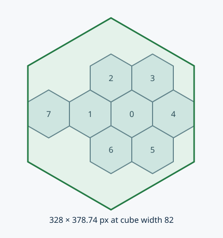

# Info Cube — beta.8 review contract

Info Cube first shipped in published **v1.9.0-beta.7**. This guide describes its
**unpublished v1.9.0-beta.8 candidate** refinements; stable remains v1.8.1. Do not
generate Info configuration for older versions. No HA helper, backend or device
service is required. All examples use synthetic entities and mock plans.

## Open and return

An ordinary Hub item or any module/menu button can use the same action:

```yaml
type: custom:honeycomb-persistent-hub
size: 82
logo: auto
items:
  - type: generic
    name: Info
    icon: mdi:information-outline
    slot: 1
    tap_action:
      action: honeycomb-info
      info:
        title: Home overview
        colors:
          center: '#34383d'       # Center fill; independent of both borders
          inner_border: '#f4a0c9'
          outer_border: '#23282e'
        connector: true          # Inherit the originating cube's inner border
        footer:
          entity: sensor.energy_a
          prefix: 'Energy: '
          suffix: ' kWh'
          fallback: Waiting
        text: A long plain-text message wraps safely inside this hexagon.
```

The Info Cube is one read-only surface; it does not call an HA device service.
Tap anywhere on the hexagon, Enter, Space, Escape or normal Back returns to the
same mounted menu with its stack, selection, slots and physical anchor preserved.
Underlying cubes are inert. The backdrop absorbs input without dismissing or
click-through. Focus returns to the opener when it still exists.

Exactly **30 seconds from opening**, the complete calling menu closes. Scrolling,
HA updates and interactions do not extend this lifetime. A persistent Hub returns
to its normal floorplan base; it is not removed from the dashboard permanently.
A fresh explicit opening replaces the Info view and starts a new lifetime.
Component removal/editor teardown cancels timers and modal listeners immediately.
Normal caller idle-close restarts after explicit return. Late asynchronous menu
navigation while suspended is discarded; it cannot resurrect another submenu.

## Verified footprint and coordinates



The latest owner geometry replaces beta.7's enclosing 0–7 polygon. Logical 0 is
still the calling cluster center; 1–6 form its first ring. Intersections of those
six full-cell polygons determine the inward V-shaped perimeter notches. The
largest **centered regular pointy hex** inside all six notch half-planes is:

| Numeric cube width | Maximum Info width | Maximum Info height | Center offset |
|---|---|---|---|
| 82 px | 163.1443 px | 188.3827 px | 0 / 0 px |
| 41 px | 81.5721 px | 94.1914 px | 0 / 0 px |

The slight difference from exactly two cube widths is intentional: existing
`.865`/`1.725` layout coordinates overlap slightly. Real shared-cell vertices and
all six bounds are used, rather than idealized outer corners. Source slot and
payload length never change this maximum. `scale` (0.5–1, default 1) permits a
smaller panel. A three-background-cube composition is valid; no minimum background
cube count is imposed and the overlay never grows to expose more cubes.

Geometry uses the caller's existing numeric engine, including `size: auto` and
`auto_reference_width`. Available viewport space may reduce the panel around the
same center, with 12px margin; it never moves the cluster or shifts Info away from
it. Keep the caller anchor within the visible floorplan. Background remains
transparent; uncovered original cubes stay visible, mounted, unchanged and inert.
Anchor style/size observation follows responsive layout updates and is disposed
when Info closes. Fixed configured CSS font sizes remain readable; additional
text paginates instead of changing geometry. Very small panels may hit the normal
content limits; use a practical caller size for long information.

Positioned blocks use normalized **x/y from 0–100**, measured from the left/top
of the complete large hexagon bounding box. `z` is drawing order, not 3D depth.
Pixel conversion: `x_px = x / 100 × info_width`, `y_px = y / 100 × info_height`.
x is the text anchor (`left`, `center`, `right`); y starts the block's line box.
Per-line safe widths follow all six sides, including the line's top and bottom,
5px border allowance and content padding. Invalid coordinates fail validation;
valid coordinates too close to a sloping edge clamp inward, with diagnostics.

## Three modes, one schema

| Field | Contract |
|---|---|
| `mode` | `text` (default), `stack`, `positioned` |
| `title`, `footer` | Optional plain string or safe entity binding; custom footer wraps/paginates as content |
| `text` | Required in text mode; string or binding |
| `blocks` | Stack/positioned array of strings or objects with `text` |
| `spacing` | Stack gap, 0–40 CSS px, default 6 |
| `padding` | Content padding, 8–40 CSS px, default 12; added to border allowance |
| `font_size` | Body default 14 CSS px; permitted 12–32; never automatically shrunk |
| `weight` | 400/500/600/650/700/800; default 400; title 700 |
| `align` | `left` default, `center`, `right` |
| `colors` | Independent `center` (center fill), `inner_border`, `outer_border`, `foreground` CSS colors |
| `scale` | 0.5–1, default 1; fraction of notch-bounded maximum, never grows with text |
| `connector` | true (default), false, or object with optional CSS `color` |

Each object block can override `font_size`, `weight`, `align`, `color` and
`background`. Positioned mode additionally requires x/y and permits z (−1000 to
1000, default 0). Blocks draw in ascending z; equal-z order is stable. Overlapping
blocks are an explicit authoring choice; containment still applies. Title remains
automatic at the top; an optional custom footer uses the same safe wrapping and
binding contract and is appended to content, above the built-in return/page hint. No HTML, Markdown rendering, CSS URLs or JavaScript templates
are executed inside Info text; special characters remain literal text.

Neutral fill/inner border and dark outer border reuse the shared renderer's Light
submenu defaults. Explicit Info colors override only this view. Existing Light,
Sonos station colors and Hub base styles remain unchanged.

The connector is a source-facing edge segment inside the border gutter, never
through content. Its default color is the **originating cube’s resolved inner
border**, independently of Info colors. `connector: {color: '#f08020'}` overrides
it; `connector: false` disables it. All physical slots and promoted/nested callers
use actual source coordinates. A center-origin source has no direction, so the
top edge is marked. No red endpoint dots are drawn.

- [One wrapped paragraph](../examples/info-text.yaml)
- [Automatic vertical stacking](../examples/info-stack.yaml)
- [Positioned x/y/z blocks](../examples/info-positioned.yaml)
- [Dynamic HA information](../examples/info-dynamic.yaml)
- [Complete synthetic quarter-hour EV plan](../examples/info-charging-plan.yaml)

## Live data without JavaScript

A text binding is an object with required `entity` and optional `attribute`,
`prefix`, `suffix`, `fallback`, `format`, `time_zone`, `max_age`, `stale_text`.
The default reads HA state; `attribute` reads one scalar attribute. Missing,
unknown, unavailable and non-scalar values show `fallback` (default Unavailable).
`format: datetime` accepts an ISO timestamp and formats in explicit `time_zone`
(default UTC), including DST. Invalid timestamps fall back safely. `max_age`
(1–86400 seconds) evaluates HA `last_updated` on each relevant HA update; an old or
missing timestamp shows `stale_text` (default Stale). It does not poll or invent a
live backend timer. Prefix/suffix also surround fallback/stale text, so choose
wording appropriately. Binding entities are the only redraw dependencies; unrelated
HA updates do not remeasure text or restart the lifetime. Blank payloads show
No information available.

## Overflow, accessibility and bounds

Text and stack modes paginate at fixed readable sizes. Wheel, vertical swipe or
PageDown/PageUp/ArrowDown/ArrowUp change pages. A tap always returns. The fixed
30-second lifetime still applies to long payloads; this is a brief information
view, not a persistent document reader. The page footer and screen reader announce
page number. No wheel/touch scroll propagates to the floorplan. Screen readers get
title, full text, return instructions and diagnostic messages; Tab stays in the
modal. Only the topmost modal handles keyboard events across multiple Hubs.

Positioned content that cannot fit vertically is explicitly truncated; use stack
mode for automatic pagination. Bounds: 128 blocks, 32768 resolved characters,
64 pages, bounded configuration size. A visible Content limited indication and
accessible diagnostics report truncation. Coordinates/font sizes/unknown fields
outside the contract produce `Info Cube:` configuration errors. Text is protected
by both line geometry and a conservative SVG hex clip. No arbitrary font loading,
external artwork, scripts, polling or HA commands belong to this component.

## Module author API

See [module authoring](MODULE_AUTHORING.md). Internal modules call
`honeycombNG.openInfoInContext(context, payload, sourceElement)` from their existing menu context.
`honeycombNG.openInfo(payload)` targets the currently open classic/global menu.
The third argument is optional; omit it to use the calling center as the source.
Declarative cube actions pass their own source automatically. These return the Info view, or null if no active caller/preview. Do not create a
separate modal, push fake Back levels or duplicate the cube renderer. All future
Climate/Car modules can use this API without importing another domain module.
No Climate, Car or speculative CM integration is implemented in beta.8.

## Acceptance

Automated Chromium covers synthetic desktop/tablet/mobile, per-line bounds,
root/module/palette return, timeout, repeated opens, touch/keyboard, live state,
late navigation, removal and multiple hosts. Screenshots live in CI evidence.
Actual owner Info Cube, Terminal add-on and HACS acceptance are separate. Do not
publish beta.8 or close #140 until owner review and explicit publication approval.
