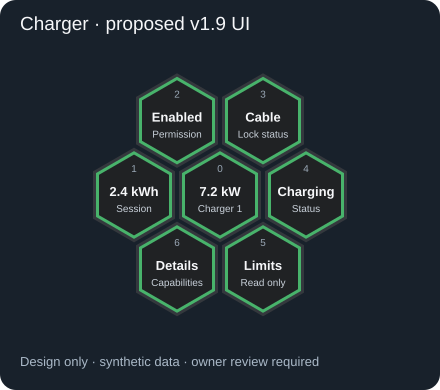
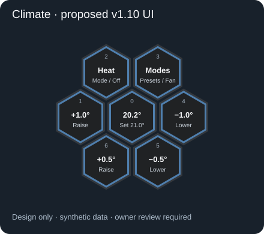
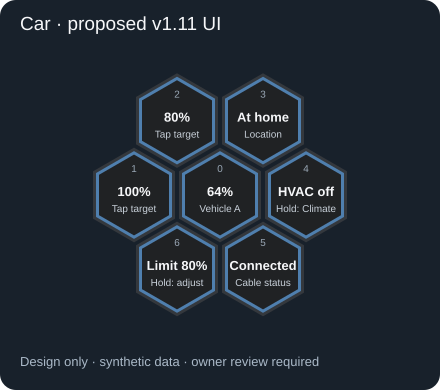
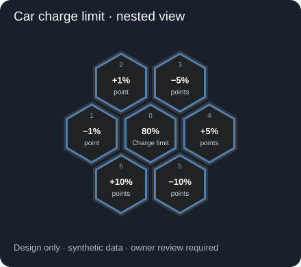

# Future module capability study — research only (2026-10-21)

No production module, dashboard schema or service implementation is added here.
Roadmap order: v1.8 shared presentation → v1.9 Charger (#105) → v1.10 Climate
(#87) → v1.11 Car (#86). Every implementation still requires architecture review,
complete tests and real-device owner approval. Mock values/entities are synthetic.
Use the one Light-based 82px renderer and existing navigation/action boundaries.

## Source evidence

HA core audited at `6481e267c53df669c1440ea2e4a3b290585e32a5`:
[Tesla Fleet number](https://github.com/home-assistant/core/blob/6481e267c53df669c1440ea2e4a3b290585e32a5/homeassistant/components/tesla_fleet/number.py),
[Fleet sensors](https://github.com/home-assistant/core/blob/6481e267c53df669c1440ea2e4a3b290585e32a5/homeassistant/components/tesla_fleet/sensor.py),
[Fleet climate](https://github.com/home-assistant/core/blob/6481e267c53df669c1440ea2e4a3b290585e32a5/homeassistant/components/tesla_fleet/climate.py).
[HA climate developer contract](https://developers.home-assistant.io/docs/core/entity/climate/).

Easee community integration audited at
`c57d085a5ff8e1df3c8938e2a4c63ba4d1d6f683`:
[entity definitions](https://github.com/fondberg/easee_hass/blob/c57d085a5ff8e1df3c8938e2a4c63ba4d1d6f683/custom_components/easee/const.py),
[services](https://github.com/fondberg/easee_hass/blob/c57d085a5ff8e1df3c8938e2a4c63ba4d1d6f683/custom_components/easee/services.yaml).
This is a third-party integration, not HA core; installed version must be verified.

Tesla Custom investigation uses the current `alandtse/tesla` **dev** branch:
[number](https://github.com/alandtse/tesla/blob/dev/custom_components/tesla_custom/number.py),
[climate](https://github.com/alandtse/tesla/blob/dev/custom_components/tesla_custom/climate.py),
[binary sensors](https://github.com/alandtse/tesla/blob/dev/custom_components/tesla_custom/binary_sensor.py).
This is an identified candidate integration, not confirmation of the owner's
installed fork/version. Entity registry platform/config-entry identity and exact
installed versions must be confirmed before producing automatic adapter rules.
Never use vehicle names/entity-ID substrings to choose a writable capability.

## Charger #105 — generic normalized state, Easee first adapter

The numbered detail layout is a **proposal**, not an owner-approved slot contract.
Slot 0 shows current kW and charger identity; inner slots expose verified session,
permission, lock/status and detail capabilities. Missing capabilities remove or
clearly disable controls without repurposing a slot during a gesture.

| Normalized capability | Verified Easee source | Boundary / proposed HA action |
|---|---|---|
| Reported status | `state.chargerOpMode`, EASEE_STATUS mapping | Disconnected, awaiting_start, charging, completed, error, ready_to_charge, authorization/load-balancing/scheduled states; do not equate waiting with charging |
| Charging power | `state.totalPower`, **kW** sensor | Validate finite, nonnegative value/unit/freshness; W↔kW conversion explicit |
| Session energy | `state.sessionEnergy`, **kWh** | Informational; no sessions or reset logic in Honeycomb |
| Enabled permission | `config.isEnabled`, switch `enable_charger` | Existing HA `switch.turn_on/off` only after explicit action; not actual charging proof |
| Cable lock | `state.cableLocked` binary sensor uses inverted bool for LOCK device class; `state.lockCablePermanently` switch | Separate physical lock vs permanent policy. Do not infer connected cable from lock alone |
| Manual pause/resume | `easee.action_command`, required `device_id` and exact `action_command` | Registry-verified charger device target; not guessed entity targeting. Explicitly whitelist pause/resume after adapter validation |
| Optional currents | Integration current/limit entities and services | Read-only initially; no optimizer, schedules, firmware, reboot or policy override by opening |
| Availability/fault | HA availability plus explicit status/error evidence | Unknown/offline not zero power; stale prior fault/charging not fresh state |

State presentation: verified active charging **and fresh power >0** → green
inner border/current kW and optional shared wave; connected/ready → blue; paused
→ neutral; verified fault → red; unavailable → gray. A charging report at zero
measured power never animates. Do not claim cable presence from a missing entity;
resolve explicit capability or display unknown. Active fill follows shared
CubePresentation; opening only navigates. Any permission/pause command is inside
an explicit action control, with pending/error feedback and no implicit retry.

Adapter selection: config-entry platform + verified same physical device,
exact integration capability keys; explicit mapping overrides discovery. Duplicate
or multi-device ambiguity fails closed. Charger/vehicle association and price,
load balancing, automatic unplug disable and scheduling belong to external HA.

QA: W/kW, null/negative/stale power, waiting/authorization vs charge, faults,
network loss, cable/permission distinction, two chargers, dynamic visibility,
reduced motion, no service on open/hold navigation, commands on correct registry
device, rejected commands, power zero/positive wave transitions and physical Easee.

## Climate #87 — reusable cross-entity capability model

Mock assumes **°C, 0.5° native step**. Proposed physical slots: 0 current/target;
1 +1.0°; 2 supported mode/off; 3 modes/presets/fan categories; 4 −1.0°;
5 −0.5°; 6 +0.5°. Owner must settle slot-2 semantics. Increments are shown only
when representable on the actual native step, not hardcoded for all thermostats.

- Read `supported_features`, `temperature`, `target_temp_low/high`, unit,
  `target_temp_step`, min/max and actual mode/preset/fan/swing lists. Missing or
  read-only targets must not show fake writable controls.
- Celsius and Fahrenheit use their own native increments/rounding; do not convert
  a displayed 0.5°C delta into 0.5°F by accident. Round on a consistent native
  lattice. Dual-target modes require a reviewed low/high target selection UI;
  never send a single temperature to the wrong channel.
- Category cubes use only advertised values and applicable HA climate actions:
  set_temperature, set_hvac_mode, set_preset_mode, set_fan_mode, set_swing_mode.
  Do not fabricate a Defrost preset. A native exact preset is valid; otherwise
  discover an eligible device-associated switch only through verified capability
  metadata or explicit mapping. Cross-device vehicle topology ambiguity requires
  explicit override, never fuzzy names.
- Cross-entity frame contract: each navigation frame retains module ID, entity,
  config, state, parent and Back identity. Car sensor → Climate entity → Back
  restores Car context without rebinding services. This is **real child depth**,
  not Sonos sibling replacement. Reuse existing controller; audit what it already
  supports before adding APIs. Late updates/actions cannot target abandoned frames.

QA matrix: Celsius 0.5/1.0, Fahrenheit 1.0, min/max edges, heat/cool/off, dual
setpoints, no target, unavailable, advertised presets/fan/swing additions/removal,
separate defrost switch/ambiguous devices, Car A→Climate A vs Car B→Climate B,
Back/idle/drag and service rejection. No production Climate implementation here.

## Car #86 — one UI with two adapters, exact approved base slots

| Slot | Approved behavior |
|---|---|
| 0 | Vehicle icon/artwork + live battery SoC |
| 1 | Single tap sets 100% target if writable; no confirmation requested |
| 2 | Single tap sets 80% target if writable |
| 3 | Current textual location; no map |
| 4 | Short tap supported HVAC on/off; hold real nested Climate on its own entity |
| 5 | Cable-connected status, read-only |
| 6 | Current charge limit; hold nested adjustment menu |

**No Update, Wake/Refresh replacement, default slot 7 or outer ring.** Opening
Car, Climate or the charge-limit submenu never changes vehicle state.

Adjustment submenu: center current limit; proposed inner slots 1 −1%, 2 +1%,
3 −5%, 4 +5%, 5 −10%, 6 +10% **percentage points**. The six meanings are owner
approved; their illustrated order is a review proposal. Every action reads the
current acknowledged value, validates min/max/step/availability and sends one
verified HA number action. Serialize rapid presses or visibly disable pending
commands; do not stack optimistic arithmetic on stale HA state. A 100%/80%
preset outside actual writable limits is disabled, never silently clamped.

| Capability | Tesla Fleet source evidence | Tesla Custom candidate evidence |
|---|---|---|
| Charge target | `charge_state_charge_limit_soc` Number, step 1, dynamic min/max; HA number.set_value | TeslaCarChargeLimit Number calls change_charge_limit, step 1, runtime min/max with integration fallbacks; HA number.set_value |
| Battery / charge / power / range | Sensor keys battery_level, charging_state, charger_power, battery_range; check actual units | Exact associated sensor entities must be audited against installed version; do not assume Fleet unique IDs |
| Cable presence | `conn_charge_cable` sensor is **not automatically Boolean presence** | TeslaCarChargerConnection binary sensor PLUG; reports charging_state != Disconnected with cable attributes; unavailable/staleness still checked |
| HVAC | Climate HEAT_COOL/OFF, capability flags; preset list off/keep/dog/camp (no invented defrost preset) | Climate HEAT_COOL/OFF, presets normal/defrost/keep/dog/camp in audited candidate |
| Defrost | Not in audited Fleet climate presets; investigate associated switch through registry or explicit override | Native exact defrost preset in candidate climate; Climate owns this capability |
| Location / online / locks | Device tracker and related entities require separate platform audit and permissions; no invented coordinates/actions | Same; installed integration may differ and needs exact mapping |

All normalized capabilities include source entity, availability/freshness,
read/write permissions, units and allowed actions. Config-entry/device association
plus adapter rules determine identity; explicit per-vehicle mapping wins. Never
share state/action targets between two vehicles, wake silently, embed vendor APIs
or implement charging optimization. Physical Fleet command permissions, signing,
latency/asleep behavior and Tesla Custom variant remain hardware acceptance gates.

## Synthetic review/test cases and handoff

`slot-models.json` and the SVGs contain only synthetic visible data, not implemented
YAML. `contracts.test.js` verifies exact source geometry and seven-cell Car/Climate
menus plus the six percentage-point actions. These are design contracts, not tests
of nonexistent production adapters. Source snapshots/field evidence must be
revalidated when implementation begins. Request owner sign-off on Charger detail
slots, Climate slot 2/dual targets and Car adjustment ordering, then implement in
the roadmap order with isolated adapters and the shared renderer only.
